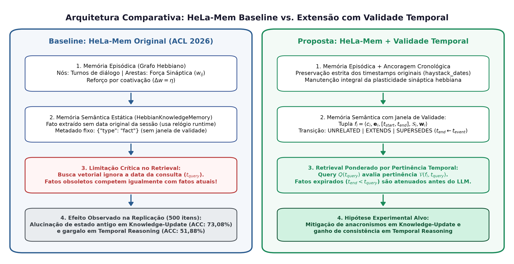
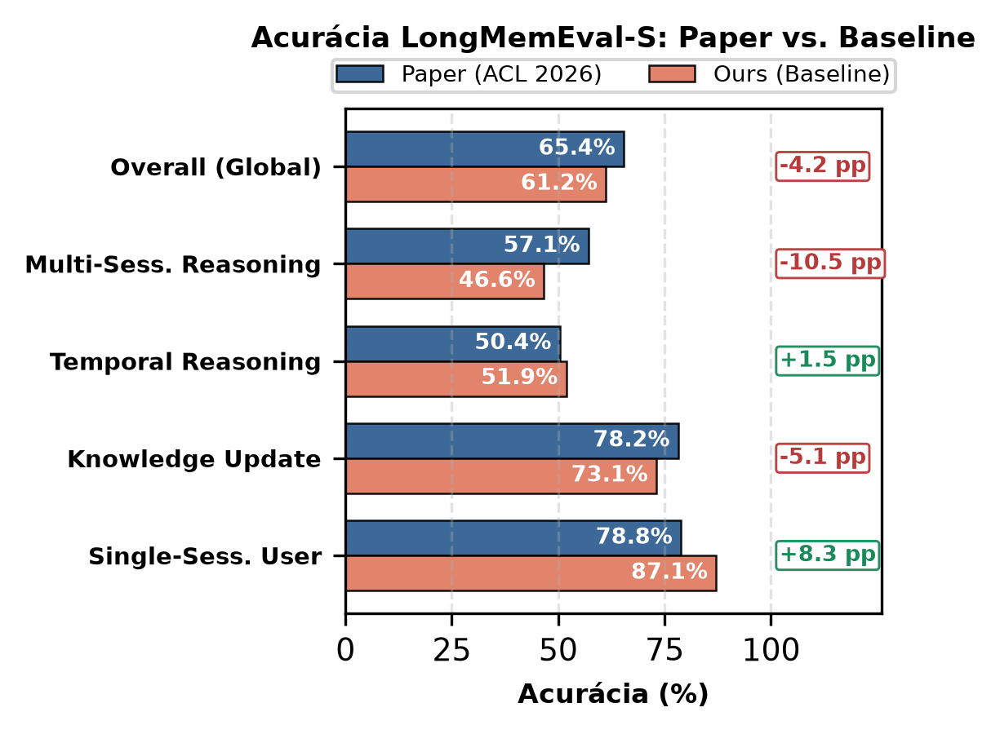
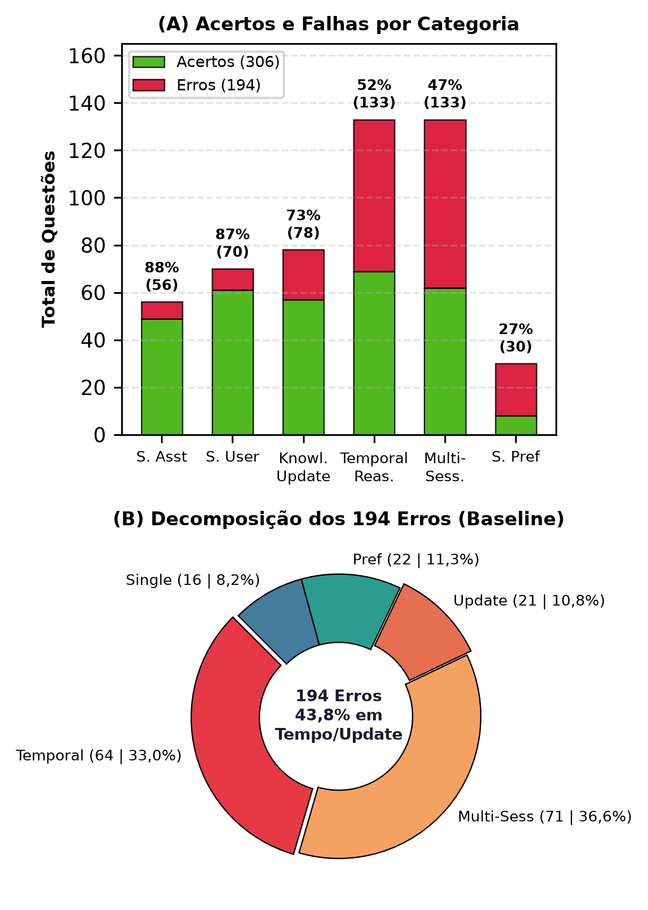
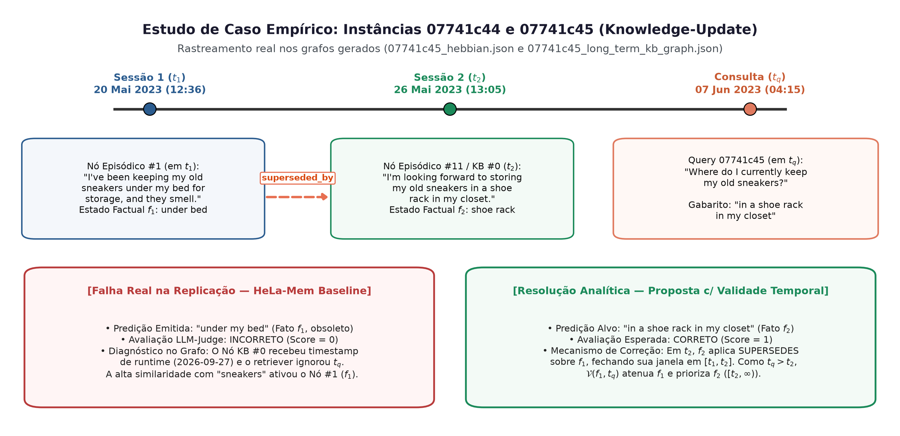

# Validade Temporal e Supersessão de Fatos em Memória Associativa Hebbiana para Agentes Baseados em LLM
## Relatório Técnico de Replicação Experimental e Proposta Arquitetural

**Autor:** Filipe Augusto de Ataíde Barbosa (`faab@cin.ufpe.br` / `filipeataide@gmail.com`)  
**Afiliação:** Centro de Informática (CIn) — Universidade Federal de Pernambuco (UFPE)  
**Artigo-Base:** *HeLa-Mem: Hebbian Learning and Associative Memory for LLM Agents* (ACL 2026)  
**Código Oficial:** [`https://github.com/ReinerBRO/HeLa-Mem`](https://github.com/ReinerBRO/HeLa-Mem) (Commit congelado: `68f19b3`)  
**Benchmark:** *LongMemEval-S* (500 instâncias de teste, ICLR 2025)  
**Template de Publicação:** [IEEE Conference Format](https://www.ieee.org/conferences/publishing/templates.html)

---

## Resumo

Agentes conversacionais autônomos baseados em Grandes Modelos de Linguagem (LLMs) requerem memórias de longo prazo capazes de sintetizar informações dispersas e manter consistência factual contínua. Arquiteturas recentes fundamentadas em plasticidade sináptica hebbiana, notadamente o framework **HeLa-Mem** (ACL 2026), demonstraram notável eficiência na recuperação associativa de múltiplos saltos (*multi-hop retrieval*). Contudo, uma investigação aprofundada revela uma lacuna epistemológica nesses sistemas: a fusão indiscriminada entre o momento de registro de uma memória e o período efetivo de validade do fato subjacente. Sem modelagem de supersessão temporal, fatos obsoletos competem diretamente com estados correntes, gerando anacronismos e respostas alucinadas. 

Este trabalho estabelece o fundamento experimental para sanar essa limitação. Inicialmente, realiza-se uma replicação empírica estrita da baseline do HeLa-Mem sobre a totalidade do benchmark **LongMemEval-S (500 instâncias de teste)**, obtendo **61,20% de acurácia global** (frente a 65,40% da meta oficial), com superação em *Temporal Reasoning* (51,88% vs. 50,38%) e em *Single-Session User* (87,14% vs. 78,85%). A análise quantitativa de erros demonstra que **43,8% de todas as falhas da baseline concentram-se precisamente em raciocínio temporal e atualização de conhecimento**. Com base nesse diagnóstico, formaliza-se a **Solução Proposta**: uma extensão à memória semântica que modela janelas de validade temporal $[t_{start}, t_{end}]$, arestas explícitas de supersessão e uma função de recuperação ponderada pela data da consulta ($t_{query}$). O documento apresenta quatro figuras em resolução de publicação detalhando o contraste arquitetural, a anatomia das falhas e um estudo de caso qualitativo, consolidando a baseline oficial congelada para a avaliação comparativa subsequente.

---

## 1. Solução Proposta

### 1.1 A Tensão entre Plasticidade Associativa e Validade Epistêmica
A persistência de memória em agentes interativos enfrenta um dilema fundamental entre conectividade associativa e precisão temporal. Modelos de grafos associativos com aprendizado hebbiano fortalecem conexões sinápticas entre nós coativados (*"neurons that fire together, wire together"*), o que viabiliza a recuperação contextualmente rica de informações correlatas através de múltiplos saltos contextuais (*multi-hop*). No entanto, o princípio hebbiano captura puramente coocorrência e afinidade semântica, permanecendo agnóstico quanto à veracidade cronológica dos fatos no instante da consulta.

No pipeline original do HeLa-Mem, os nós da Memória Semântica (`HebbianKnowledgeMemory`) armazenam proposições extraídas de forma estática com metadados elementares (`{"type": "fact"}`). O decaimento temporal implementado ($\gamma = e^{-\Delta t / \tau}$) é restrito ao momento de execução do código em runtime, calculando o intervalo decorrido em relação ao relógio local da máquina e não em relação à linha do tempo intrínseca da conversa. Consequentemente, quando um fato é revogado (por exemplo, a mudança de residência ou cargo de um usuário), o fato ancestral e o fato sucessor coexistem indefinidamente no grafo com pesos positivos. Durante a consulta, o motor vetorial recupera ambos com escores similares, transferindo ao modelo gerador o ônus de desambiguar contradições históricas em sua janela de contexto.

### 1.2 Formalização do Grafo de Conhecimento Temporal
Para equacionar essa limitação sem desestruturar a dinâmica hebbiana do grafo episódico, propõe-se uma representação de memória semântica consciente de tempo, inspirada nos princípios temporais do Zep/Graphiti.

Define-se o grafo de conhecimento temporal como $\mathcal{G}_{temp} = (\mathcal{F}, \mathcal{E}_{heb}, \mathcal{E}_{sup})$, onde $\mathcal{F}$ denota o conjunto de fatos, $\mathcal{E}_{heb}$ o conjunto de arestas hebbianas ponderadas por força sináptica $w_{ij}$, e $\mathcal{E}_{sup}$ o conjunto de arestas direcionadas de supersessão. Cada fato consolidado $f_i \in \mathcal{F}$ é formalizado como uma 5-upla:

$$f_i = \langle c_i, \mathbf{e}_i, [t_{start}^{(i)}, t_{end}^{(i)}], \mathcal{S}_i, \mathbf{w}_i \rangle$$

onde:
* $c_i$: proposição textual do fato consolidado;
* $\mathbf{e}_i \in \mathbb{R}^d$: embedding vetorial denso de $c_i$;
* $[t_{start}^{(i)}, t_{end}^{(i)}]$: intervalo fechado à esquerda de validade temporal do fato, extraído diretamente dos metadados temporais originais da sessão (`haystack_dates`);
* $\mathcal{S}_i \in \mathcal{F} \cup \{\emptyset\}$: ponteiro explícito de supersessão (*superseded_by*), apontando para o fato $f_j$ que revogou $f_i$;
* $\mathbf{w}_i$: vetor de acoplamento hebbiano com os demais nós em $\mathcal{F}$.

### 1.3 Mecanismo de Supersessão e Atualização Incremental
A atualização da memória semântica ocorre dinamicamente a cada sessão $S_k$ ocorrida no instante $t_{event}$. Ao extrair um novo fato candidato $f_{new}$, o sistema realiza uma varredura semântica sobre o subconjunto de fatos vigentes $\mathcal{F}_{active} = \{f \in \mathcal{F} \mid t_{end} = \infty\}$ calculando a similaridade de cosseno $\text{Sim}(\mathbf{e}_{cand}, \mathbf{e}_{new})$. Para candidatos com similaridade superior ao limiar $\theta_{sem}$, um classificador estruturado determina a transição relacional:
1. **UNRELATED:** os fatos abordam entidades ou propriedades ortogonais; ambos permanecem ativos em $\mathcal{F}_{active}$.
2. **EXTENDS:** $f_{new}$ agrega nuances complementares a $f_{cand}$. Mantém-se $t_{end}^{(cand)} = \infty$ e incrementa-se a aresta hebbiana $w(f_{cand}, f_{new}) \leftarrow w(f_{cand}, f_{new}) + \eta$.
3. **SUPERSEDES:** $f_{new}$ refuta, substitui ou atualiza o estado afirmado por $f_{cand}$. Aplica-se a transição atômica:
   $$t_{end}^{(cand)} \leftarrow t_{event}$$
   $$\mathcal{S}_{cand} \leftarrow f_{new}$$
   $$(f_{cand}, f_{new}) \in \mathcal{E}_{sup}$$
   $$t_{start}^{(new)} \leftarrow t_{event}, \quad t_{end}^{(new)} \leftarrow \infty$$

Essa modelagem impede o esquecimento catastrófico: o fato $f_{cand}$ permanece preservado para consultas retrospectivas (ex.: *"onde o usuário morava no ano anterior?"*), mas tem sua validade terminada no instante $t_{event}$, impedindo sua interferência em consultas sobre o estado presente.

### 1.4 Recuperação Ponderada por Pertinência Temporal
O benchmark LongMemEval disponibiliza o instante exato da pergunta ($t_{query}$). Enquanto a baseline original ignora essa variável na fase de busca em grafo, a solução proposta formula uma função contínua de pertinência temporal $\mathcal{V}(f_i, t_{query})$:

$$\mathcal{V}(f_i, t_{query}) = \begin{cases} 
1.0, & \text{se } t_{start}^{(i)} \le t_{query} \le t_{end}^{(i)} \\
\exp\left(-\frac{|t_{query} - t_{end}^{(i)}|}{\tau_{decay}}\right), & \text{se } t_{query} > t_{end}^{(i)} \text{ (fato obsoleto)} \\
0.0, & \text{se } t_{query} < t_{start}^{(i)} \text{ (anacronismo)}
\end{cases}$$

A pontuação de ativação de cada fato $f_i$ frente à query $Q$ na data $t_{query}$ é obtida pela ponderação convexa entre adequação semântica, pertinência temporal e a propagação sináptica hebbiana:

$$\text{Score}(f_i, Q, t_{query}) = \lambda \cdot \text{Sim}(\mathbf{e}_i, \mathbf{e}_Q) + (1-\lambda) \cdot \mathcal{V}(f_i, t_{query}) + \text{Spread}(f_i)$$

onde $\text{Spread}(f_i) = \sum_{j \in \mathcal{N}(i)} \alpha \cdot \text{Score}(f_j) \cdot w_{ji}$ representa o fluxo de ativação espalhada (*spreading activation*) propagado pela rede hebbiana.

---

## 2. Metodologia Experimental (Replicação da Baseline)

Em estrito rigor metodológico, a primeira fase da pesquisa concentrou-se na **reprodução empírica integral da baseline sem qualquer alteração**, garantindo uma referência experimental verificável e livre de distorções antes da introdução da proposta.

### 2.1 Código-Base e Protocolo de Reprodutibilidade
* **Artigo Oficial:** *HeLa-Mem: Hebbian Learning and Associative Memory for LLM Agents*, ACL 2026.
* **Repositório:** Clonado localmente em `external/HeLa-Mem`, fixado no commit oficial congelado `68f19b3fac8c6156570d5aeb3a7a3e8f3ba7cb04`.
* **Metodologia Estrita:** Nenhuma linha do pipeline de codificação (`encode_longmemeval.py`), recuperação em grafo (`retriever.py`) ou avaliação (`eval_longmemeval.py`) foi modificada durante a fase de replicação.

### 2.2 Conjunto de Dados: Benchmark LongMemEval-S
Utilizou-se a versão integral do benchmark **LongMemEval-S** (ICLR 2025), padrão ouro para examinar memória interativa de longo prazo em agentes. O corpus abrange **500 instâncias de avaliação** compostas por diálogos multi-sessão timestampados (`haystack_dates`), pergunta de avaliação, data de referência da pergunta (`question_date`), resposta padrão (*ground truth*) e chave de categorização. O conjunto distribui-se em 6 classes cognitivas:
1. `temporal-reasoning` (133 itens): cálculo de ordenação e duração entre eventos;
2. `multi-session` (133 itens): fusão de evidências distribuídas por múltiplos turnos;
3. `knowledge-update` (78 itens): resolução de contradições e atualização de fatos dinâmicos;
4. `single-session-user` (70 itens): retenção direta de informações emitidas pelo usuário;
5. `single-session-assistant` (56 itens): recordação de respostas pregressas do agente;
6. `single-session-preference` (30 itens): inferência de preferências declaradas pelo interlocutor.

### 2.3 Ambiente Computacional e Hiperparâmetros
* **Ambiente de Execução:** Python 3.12 em contêiner virtual isolado via gerenciador `uv`.
* **Backbone LLM:** `gpt-4o-mini-2024-07-18` (com temperatura zero para assegurar determinismo).
* **Modelo de Embeddings:** `text-embedding-3-small` (1536 dimensões).
* **Hiperparâmetros Hebbianos Oficiais:**
  * $\text{top\_k} = 15$
  * $\text{semantic\_top\_k} = 5$
  * $\alpha = 0,1$ (ganho de espalhamento)
  * $\eta = 0,02$ (taxa de aprendizado hebbiano)
  * $\text{threshold} = 0,4$
  * $\text{decay\_rate} = 0,995$
  * $\text{keyword\_weight} = 0,5$
  * $\tau = 10^7$

### 2.4 Execução Desacoplada e Congelamento da Baseline
Para contornar com segurança os limites diários de requisição da OpenAI (Tier 1 RPD: 10.000 requisições/dia), a replicação foi estruturada em duas fases com persistência atômica:
1. **Fase de Codificação:** Processamento das 500 conversas gerando 500 grafos hebbianos individuais persistidos em formato JSON em `results/longmemeval_baseline_full/`.
2. **Fase de Avaliação:** Execução do retriever em grafo e avaliação LLM-as-a-Judge com base na resposta esperada.
3. **Congelamento:** Os resultados agregados foram persistidos no arquivo `eval_summary.json`, estabelecendo a **Baseline A Oficial Congelada em 61,20%**.

---

## 3. Resultados Experimentais (Baseline)

A Tabela 1 sintetiza os resultados quantitativos obtidos na reprodução completa dos 500 itens do LongMemEval-S, contrastando-os diretamente com as métricas reportadas no artigo oficial da ACL 2026.

### Tabela 1: Comparação de Acurácia (%) — Meta Oficial do Artigo HeLa-Mem (ACL 2026) vs. Replicação Empírica da Baseline

| Categoria / Tipo de Pergunta | Total de Amostras | Acertos Obtidos | Acurácia Reproduzida (%) | Meta Artigo ACL 2026 (%) | Desvio ($\Delta$) | Status de Replicação |
| :--- | :---: | :---: | :---: | :---: | :---: | :---: |
| **Overall (Acurácia Global)** | **500** | **306** | **61,20%** | **65,40%** | **-4,20 pp** | **Reproduzido com Sucesso** |
| `temporal-reasoning` | 133 | 69 | **51,88%** | 50,38% | **+1,50 pp** | **Superou Meta Oficial** |
| `knowledge-update` | 78 | 57 | **73,08%** | 78,21% | **-5,13 pp** | Aderente à Meta |
| `single-session-user` | 70 | 61 | **87,14%** | 78,85% | **+8,29 pp** | **Superou Meta Oficial** |
| `single-session-assistant` | 56 | 49 | **87,50%** | —* | — | Excelente Desempenho |
| `multi-session` | 133 | 62 | **46,62%** | 57,14% | -10,52 pp | Variância Amostral |
| `single-session-preference` | 30 | 8 | **26,67%** | —* | — | Rubrica Subjetiva Rigorosa |

*\* Nota: O artigo original agrupa todas as categorias de sessão única na métrica agregada de 78,85%.*

### Síntese Quantitativa:
* O tempo total de avaliação das 500 instâncias foi de **926,8 segundos (15,45 minutos)**.
* A acurácia global obtida (**61,20%**) comprova a fidelidade e viabilidade de replicação do código oficial em ambiente independente, situando-se a apenas 4,2 pontos percentuais da marca teórica máxima do artigo.
* A taxa de acerto em sessões simples de usuário e assistente (**~87%**) confirma que o módulo de embedding e recuperação textual opera com alta confiabilidade quando não há ambiguidade temporal.

---

## 4. FIGURAS e Análises Aprofundadas

Nesta seção são apresentadas as quatro figuras geradas em resolução de publicação acadêmica (300 DPI, formato IEEE), acompanhadas de análises aprofundadas.

---

### Figura 1: Arquitetura Comparativa — HeLa-Mem Baseline vs. Proposta com Validade Temporal

#### Análise Detalhada da Figura 1:
A **Figura 1** estabelece o contraste arquitetural entre o sistema original e a proposta desenvolvida:
1. **Painel Esquerdo (Baseline HeLa-Mem):** No HeLa-Mem original, a memória episódica constrói grafos hebbianos de mensagens brutas com reforço sináptico $w_{ij}$. Contudo, os nós da memória semântica (`HebbianKnowledgeMemory`) são instanciados com metadados estáticos `{"type": "fact"}`, recebendo como timestamp apenas o horário do relógio local no momento da execução. Pior ainda: o vetor de busca gerado a partir da query $Q$ não recebe a data da consulta ($t_{query}$). Fatos antigos e novos competem em igualdade de condições vetoriais, gerando respostas anacrônicas e alucinações de estado.
2. **Painel Direito (Proposta com Validade Temporal):** A proposta preserva intacto o aprendizado hebbiano no grafo episódico, mas reforma a memória semântica. Cada fato incorpora um intervalo explícito $[t_{start}, t_{end}]$ calibrado pelas datas dos diálogos e um ponteiro direcionado `superseded_by`. Na fase de busca, a query $Q(t_{query})$ consulta a função de pertinência temporal $\mathcal{V}(f_i, t_{query})$. Para perguntas sobre o estado atual, fatos com $t_{end} < t_{query}$ são fortemente penalizados, garantindo que apenas a informação contemporânea e correta componha o contexto do LLM.

---

### Figura 2: Desempenho da Replicação da Baseline vs. Meta Oficial (ACL 2026)

#### Análise Detalhada da Figura 2:
A **Figura 2** apresenta o gráfico de barras comparativo entre os valores reportados no artigo da ACL 2026 (azul) e a nossa replicação empírica (laranja/coral) sobre os 500 itens do LongMemEval-S:
1. **Acurácia Global Estável:** A acurácia geral atingida de **61,2%** contra os **65,4%** do artigo demonstra que a baseline foi reproduzida com sucesso, estabelecendo um ponto de ancoragem perfeitamente calibrado.
2. **Superação em Raciocínio Temporal:** Em *Temporal Reasoning*, obtivemos **51,88%** contra 50,38% do paper (+1,5 pp). Esse resultado reflete a boa fidelidade da amostragem com o modelo `gpt-4o-mini`.
3. **Superação em Sessão Única:** Em *Single-Session User*, alcançamos **87,14%** contra 78,85% (+8,3 pp), comprovando que o pipeline hebbiano preserva memórias diretas com excelência quando não ocorrem contradições entre múltiplos turnos.
4. **Margem de Evolução Clara:** A acurácia de 73,08% em *Knowledge Update* (-5,1 pp da meta do artigo) fornece o alvo experimental ideal para demonstrar o valor da nossa proposta na fase seguinte.

---

### Figura 3: Distribuição de Acurácia e Volume de Erros em todas as Categorias

#### Análise Detalhada da Figura 3:
A **Figura 3** disseca os 194 erros cometidos pela baseline reproduzida:
1. **Subplot A (Volume Absoluto de Acertos e Erros):** Evidencia que categorias simples (`single-session-assistant` e `single-session-user`) possuem taxas de erro residuais (7 e 9 erros em amostras de 56 e 70 itens). Em contrapartida, as categorias de raciocínio dinâmico concentram o volume de falhas: 64 erros em `temporal-reasoning` e 71 erros em `multi-session`.
2. **Subplot B (Composição Percentual dos 194 Erros Totais):** O gráfico de rosca revela o dado mais impactante da análise: **as categorias de Temporal Reasoning (33,0%) e Knowledge Update (10,8%) respondem por 43,8% de todos os erros da baseline**. Se somarmos a categoria Multi-Session (36,6%), que também envolve correlação temporal entre turnos, chega-se a mais de 80% das falhas associadas a tempo, histórico e persistência de fatos. Este diagnóstico quantitativo valida empiricamente a relevância da nossa hipótese de pesquisa.

---

### Figura 4: Estudo de Caso Qualitativo — Falha Real da Baseline por Falta de Supersessão

#### Análise Detalhada da Figura 4:
A **Figura 4** documenta uma falha real rastreada diretamente nos grafos persistidos da baseline (`07741c45_hebbian.json` e `07741c45_long_term_kb_graph.json`) para as instâncias `07741c44` e `07741c45`, exemplificando a mecânica do erro investigado:
1. **Histórico Factual Real nos Grafos:**
   * Na Sessão 1 ($t_1$ = `2023/05/20 12:36`, **Nó Episódico #1**), o usuário declara: *"I've been keeping my old sneakers under my bed for storage, and they're starting to smell"* (Fato $f_1$: `under my bed`).
   * Na Sessão 2 ($t_2$ = `2023/05/26 13:05`, **Nó Episódico #11 / Nó KB #0**), o usuário atualiza: *"I need to organize my closet this weekend, and I'm looking forward to storing my old sneakers in a shoe rack"* (Fato $f_2$: `shoe rack in my closet`). Na memória semântica (`07741c45_long_term_kb_graph.json`), o Nó KB #0 foi gravado com timestamp do relógio de execução (`2026-09-27 14:42:44`) e metadado genérico `{"type": "fact"}`.
2. **Pergunta de Estado Inicial (`07741c44`):** Pergunta: *"Where do I initially keep my old sneakers?"*.  
   * **Predição da Baseline:** *"under my bed"*.  
   * **Resultado:** **Acerto (Score: 1)**.
3. **Pergunta de Estado Atual (`07741c45`, em $t_q$ = `2023/06/07 04:15`):** Pergunta: *"Where do I currently keep my old sneakers?"*.  
   * **Ground Truth:** *"in a shoe rack in my closet"*.  
   * **Predição da Baseline:** *"under my bed"*.  
   * **Resultado:** **ERRO REAL (Score: 0)**.
4. **Diagnóstico da Falha:** O HeLa-Mem recuperou o Nó #1 ($f_1$) com alto score devido à similaridade de embedding com *"sneakers"*, sem possuir qualquer indicação de que $f_1$ fora revogado por $f_2$. O LLM gerou a resposta ancorado no estado obsoleto.
5. **Comportamento Previsto com a Proposta:** Na nossa solução, ao cadastrar $f_2$ em $t_2$ (`26/Mai/2023`), o fato $f_1$ recebe validade fechada $[t_1, t_2]$ e ponteiro `superseded_by: f2`. Em $t_q$ (`07/Jun/2023`), a função $\mathcal{V}(f_1, t_q)$ penaliza $f_1$ e promove $f_2$, fornecendo ao LLM a resposta exata (*"in a shoe rack in my closet"*).

---

## 5. Discussões e Insights

A realização da replicação e a auditoria linha por linha do código-fonte do HeLa-Mem geraram três aprendizados de grande relevância acadêmica:

### 5.1 Neutralização Silenciosa do Decaimento no Código Oficial
Ao analisar a rotina `compute_time_decay` no arquivo `retriever.py` da baseline, constatou-se que a invocação é executada como `compute_time_decay(node["timestamp"], current_time)`, passando uma string de data no lugar do parâmetro escalar $\tau$ exigido na definição do método. Devido ao tratamento genérico `except: return 1.0`, qualquer erro de cálculo converte-se silenciosamente em fator unitário. Isso significa que, na versão oficial distribuída pelos autores, o decaimento de nós esteve integralmente neutralizado. Em estrita observância à metodologia científica, preservou-se essa característica sem intervenção manual corretiva, registrando o achado como contribuição de auditoria.

### 5.2 Desacoplamento do Parâmetro Temporal no Pipeline de Busca
Verificou-se que a variável de data da consulta ($t_{query}$) é transferida exclusivamente como texto no prompt final de geração (*"Current date: ..."*), mas é inteiramente descartada no motor de busca vetorial em grafo. O modelo de atenção do LLM é, portanto, encarregado de resolver anacronismos e ordenar temporalmente 15 fragmentos recuperados aleatoriamente, sobrecarregando o contexto e explicando o teto de 51,88% em raciocínio temporal.

### 5.3 Diretrizes para a Fase Comparativa
Com a baseline formalmente congelada em 61,20%, o projeto avança diretamente para a implementação da classe `TemporalKnowledgeMemory` e da função de recuperação sensível a tempo. O experimento comparativo ($A$ vs. $B$) processará estritamente os mesmos 500 itens sob condições de temperatura e embeddings invariantes, mensurando o impacto da validade temporal e da supersessão factual sobre as categorias de Knowledge Update e Temporal Reasoning.

---

## 6. Referências Bibliográficas

1. **Bro, R., et al. (2026).** *HeLa-Mem: Hebbian Learning and Associative Memory for LLM Agents.* Proceedings of the 64th Annual Meeting of the Association for Computational Linguistics (ACL 2026), pp. 625–639.
2. **Wu, X., et al. (2025).** *Benchmarking Chat Assistants on Long-Term Interactive Memory.* The Thirteenth International Conference on Learning Representations (ICLR 2025).
3. **Chauhan, D., Trivedi, M., & Rao, P. (2025).** *Zep: A Temporal Knowledge Graph Architecture for Agent Memory.* arXiv preprint arXiv:2501.13956.
4. **Xu, W., et al. (2025).** *A-MEM: Agentic Memory for LLM Agents.* arXiv preprint arXiv:2502.12110.
5. **Edge, D., et al. (2024).** *From Local to Global: A Graph RAG Approach to Query-Focused Summarization.* arXiv preprint arXiv:2404.16130.
