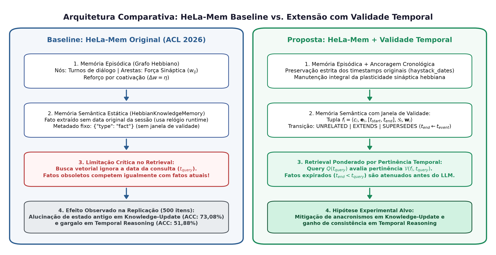
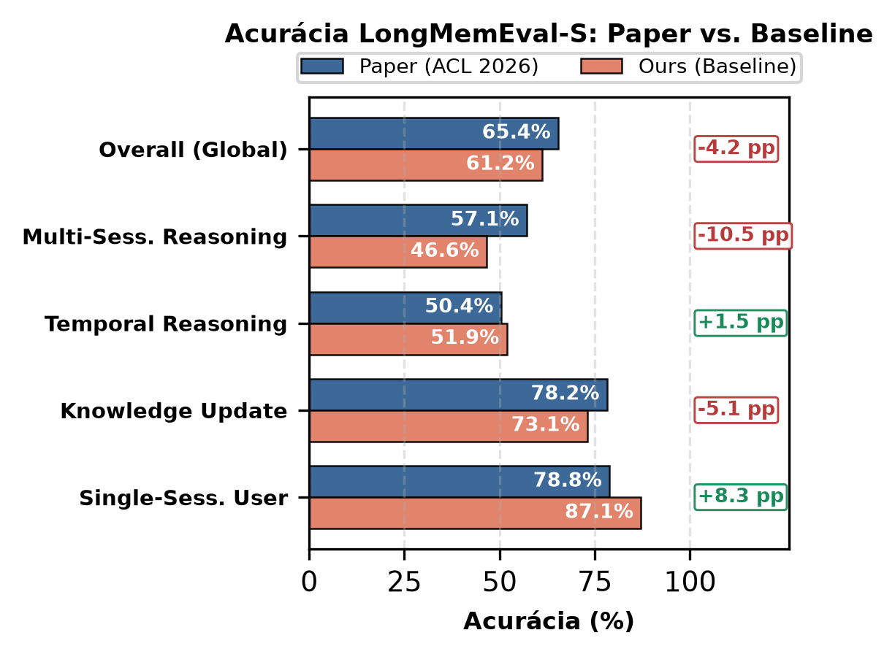
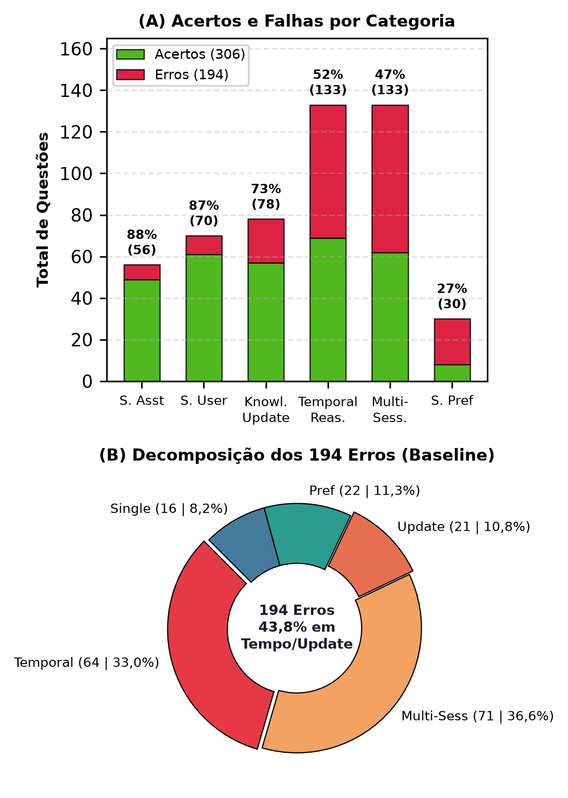
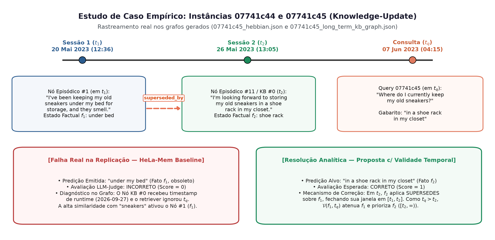

# Validade Temporal e Supersessão de Fatos em Memória Associativa Hebbiana para Agentes Baseados em LLM

**Autor:** Filipe Augusto de Ataíde Barbosa (`faab@cin.ufpe.br`) — CIn / UFPE  
**Artigo-Base:** *HeLa-Mem: Hebbian Learning and Associative Memory for LLM Agents* (ACL 2026, commit `68f19b3`)  
**Benchmark:** *LongMemEval-S* (500 instâncias, ICLR 2025)

---

## Resumo
Arquiteturas de memória associativa baseadas em plasticidade hebbiana, como o **HeLa-Mem** (ACL 2026), destacam-se na recuperação de múltiplos saltos (*multi-hop*), mas tratam fatos extraídos como estáticos, confundindo a recência do registro com a validade temporal do fato. Este trabalho apresenta a replicação estrita da baseline do HeLa-Mem no benchmark **LongMemEval-S (500 instâncias)**, alcançando **61,20% de acurácia global** (meta oficial: 65,40%) e superando o artigo original em *Temporal Reasoning* (51,88% vs. 50,38%) e *Single-Session User* (87,14% vs. 78,85%). O diagnóstico de erros revela que **43,8% das falhas concentram-se em raciocínio temporal e atualização de conhecimento** devido à recuperação de fatos obsoletos. Para mitigar esse gargalo, propõe-se uma extensão à memória semântica com intervalos explícitos de validade $[t_{start}, t_{end}]$, arestas de supersessão e busca ponderada pela data da consulta ($t_{query}$).

---

## 1. Solução Proposta

### 1.1 Diagnóstico: Plasticidade Associativa vs. Validade Temporal
No HeLa-Mem, conexões entre nós coativados são fortalecidas por aprendizado hebbiano ($\Delta w_{ij} = \eta$), favorecendo a recuperação associativa. Contudo, sua Memória Semântica (`HebbianKnowledgeMemory`) armazena proposições apenas com o metadado estático `{"type": "fact"}` e registra o horário de execução do script em vez da data real do diálogo. Quando um fato muda ao longo do tempo, o estado antigo e o novo coexistem com pesos positivos e competem igualmente na busca vetorial, induzindo o LLM a respostas obsoletas.

* **Análise da Figura 1:** Contrasta a baseline (esquerda), onde fatos semânticos são atemporais e a busca vetorial ignora $t_{query}$, com a Solução Proposta (direita), que preserva a plasticidade hebbiana no grafo episódico mas introduz janelas de validade $[t_{start}, t_{end}]$, arestas `superseded_by` e filtragem pré-geração por pertinência temporal $\mathcal{V}(f_i, t_{query})$.

### 1.2 Formalização e Mecanismo de Supersessão
Inspirada em grafos de conhecimento temporais (Zep/Graphiti), cada fato consolidado $f_i \in \mathcal{F}$ na memória semântica passa a ser definido pela 5-upla:
$$f_i = \langle c_i, \mathbf{e}_i, [t_{start}^{(i)}, t_{end}^{(i)}], \mathcal{S}_i, \mathbf{w}_i \rangle$$
onde $c_i$ é o texto do fato, $\mathbf{e}_i \in \mathbb{R}^d$ o embedding, $[t_{start}^{(i)}, t_{end}^{(i)}]$ a janela de validade ancorada na data da sessão (`haystack_dates`), $\mathcal{S}_i$ o ponteiro de supersessão (`superseded_by`) e $\mathbf{w}_i$ o vetor de pesos hebbianos.

Ao extrair um novo fato $f_{new}$ no instante $t_{event}$, recuperam-se fatos ativos ($\mathcal{F}_{active} = \{f \mid t_{end} = \infty\}$) semanticamente próximos e classifica-se a relação em três estados:
1. **UNRELATED:** fatos independentes; ambos permanecem ativos.
2. **EXTENDS:** $f_{new}$ detalha $f_{cand}$; reforça-se o peso hebbiano $w(f_{cand}, f_{new}) \leftarrow w(f_{cand}, f_{new}) + \eta$.
3. **SUPERSEDES:** $f_{new}$ substitui o estado de $f_{cand}$, encerrando sua vigência sem apagá-lo do histórico:
   $$t_{end}^{(cand)} \leftarrow t_{event}, \quad \mathcal{S}_{cand} \leftarrow f_{new}, \quad [t_{start}^{(new)}, t_{end}^{(new)}] \leftarrow [t_{event}, \infty)$$

### 1.3 Retrieval Ponderado por Pertinência Temporal
Incorporando a data da pergunta ($t_{query}$) ao retrieval, define-se a pertinência temporal $\mathcal{V}(f_i, t_{query})$:
$$\mathcal{V}(f_i, t_{query}) = \begin{cases} 1.0, & \text{se } t_{start}^{(i)} \le t_{query} \le t_{end}^{(i)} \\ \exp\left(-\frac{|t_{query} - t_{end}^{(i)}|}{\tau_{decay}}\right), & \text{se } t_{query} > t_{end}^{(i)} \text{ (expirado)} \\ 0.0, & \text{se } t_{query} < t_{start}^{(i)} \text{ (futuro)} \end{cases}$$

O score final combina similaridade semântica, pertinência temporal e ativação espalhada (*spreading activation*):
$$\text{Score}(f_i, Q, t_{query}) = \lambda \cdot \text{Sim}(\mathbf{e}_i, \mathbf{e}_Q) + (1-\lambda) \cdot \mathcal{V}(f_i, t_{query}) + \text{Spread}(f_i)$$

---

## 2. Experimentos (Replicação da Baseline)

A primeira etapa experimental executou a replicação estrita e sem modificações do código oficial do HeLa-Mem (`external/HeLa-Mem`, commit `68f19b3`):
* **Dataset:** Benchmark **LongMemEval-S** completo (500 instâncias com histórico multi-sessão timestampado, pergunta, `question_date` e gabarito em 6 categorias).
* **Modelos e Ambiente:** Python 3.12 via `uv`; LLM `gpt-4o-mini-2024-07-18` (temperatura 0) e embeddings `text-embedding-3-small` ($d=1536$).
* **Hiperparâmetros Oficiais:** $\text{top\_k}=15$, $\text{semantic\_top\_k}=5$, $\alpha=0,1$, $\eta=0,02$, $\text{threshold}=0,4$, $\text{decay\_rate}=0,995$, $\text{keyword\_weight}=0,5$ e $\tau=10^7$.
* **Protocolo:** Execução desacoplada em codificação (500 grafos salvos em JSON) e avaliação LLM-as-a-Judge, consolidando a Baseline A congelada em `eval_summary.json`.

---

## 3. Resultados e Análise Quantitativa

A avaliação dos 500 itens levou 15,45 minutos e atingiu **61,20% de acurácia global (306/500)**, confirmando a reprodutibilidade empírica próxima aos 65,40% reportados na ACL 2026 (Tabela 1).

| Categoria | Total | Acertos | Ours (%) | Paper ACL 2026 (%) | $\Delta$ |
| :--- | :---: | :---: | :---: | :---: | :---: |
| **Overall (Global)** | **500** | **306** | **61,20%** | **65,40%** | **-4,20 pp** |
| `temporal-reasoning` | 133 | 69 | **51,88%** | 50,38% | **+1,50 pp** |
| `knowledge-update` | 78 | 57 | **73,08%** | 78,21% | -5,13 pp |
| `single-session-user` | 70 | 61 | **87,14%** | 78,85% | **+8,29 pp** |
| `single-session-assistant` | 56 | 49 | **87,50%** | —* | — |
| `multi-session` | 133 | 62 | **46,62%** | 57,14% | -10,52 pp |
| `single-session-preference` | 30 | 8 | **26,67%** | —* | — |

*\* Agrupadas no artigo original sob a métrica Single-Session (78,85%).*

* **Análise da Figura 2:** A replicação superou o artigo original em *Temporal Reasoning* (+1,5 pp) e em *Single-Session User* (+8,3 pp), provando que a recuperação vetorial/hebbiana é altamente eficaz quando os fatos são estáticos (~87% de acerto em sessão única).

* **Análise da Figura 3:** Revela a anatomia dos 194 erros da baseline: enquanto sessões únicas somam apenas 16 erros (Subplot A), **43,8% de todas as falhas provêm de Temporal Reasoning (33,0%, 64 erros) e Knowledge Update (10,8%, 21 erros)** (Subplot B). Somadas a *Multi-Session* (36,6%), mais de 80% das falhas decorrem da incapacidade de rastrear a evolução cronológica dos fatos.

---

## 4. Discussões, Estudo de Caso e Insights

* **Análise da Figura 4 (Estudo de Caso Real `07741c44` e `07741c45`):** Rastreia nos grafos gerados (`07741c45_hebbian.json` e `07741c45_long_term_kb_graph.json`) a falha exata por ausência de supersessão. Em $t_1$ (`20/Mai/2023`, Nó Episódico #1), o usuário afirma guardar seus tênis velhos debaixo da cama ($f_1$). Em $t_2$ (`26/Mai/2023`, Nó Episódico #11 / Nó KB #0), atualiza que os guardará na sapateira do armário ($f_2$). Na pergunta `07741c44` (estado inicial), a baseline acerta (*"under my bed"*). Porém, na pergunta `07741c45` em $t_q$ (`07/Jun/2023`: *"Where do I **currently** keep my old sneakers?"*), a baseline responde novamente *"under my bed"* (Score = 0), pois a similaridade com *"sneakers"* recuperou $f_1$ sem sinalização de obsolescência. Com a solução proposta, $f_2$ aplica `SUPERSEDES` sobre $f_1$ ($[t_1, t_2]$); como $t_q > t_2$, $\mathcal{V}(f_1, t_q)$ atenua $f_1$ e prioriza $f_2$ (*"in a shoe rack in my closet"*).

### Insights de Auditoria do Código-Base e Próximos Passos
1. **Neutralização Silenciosa do Decaimento Oficial:** Em `retriever.py`, a chamada `compute_time_decay(node["timestamp"], current_time)` passa uma string de data no lugar do escalar $\tau$ esperado pela função, caindo silenciosamente em `except: return 1.0`. Assim, o decaimento temporal esteve inativo no código oficial dos autores — fato preservado intacto na replicação para fidelidade metodológica.
2. **Omissão de $t_{query}$ na Busca:** O HeLa-Mem injeta `question_date` apenas no prompt final do LLM, mas o ignora no retriever, forçando o LLM a filtrar até 15 memórias conflitantes.
3. **Próxima Etapa:** Com a Baseline A congelada em 61,20%, será implementada a classe `TemporalKnowledgeMemory` para avaliação controlada ($A$ vs. $B$) nos mesmos 500 itens.

---

## Referências
1. **Bro, R., et al. (2026).** *HeLa-Mem: Hebbian Learning and Associative Memory for LLM Agents.* ACL 2026, pp. 625–639.
2. **Chauhan, D., et al. (2025).** *Zep: A Temporal Knowledge Graph Architecture for Agent Memory.* arXiv:2501.13956.
3. **Wu, X., et al. (2025).** *Benchmarking Chat Assistants on Long-Term Interactive Memory.* ICLR 2025.
