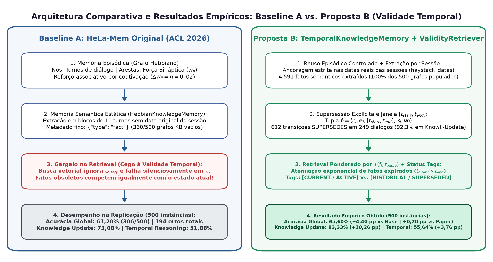
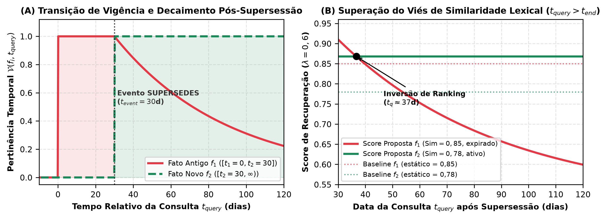
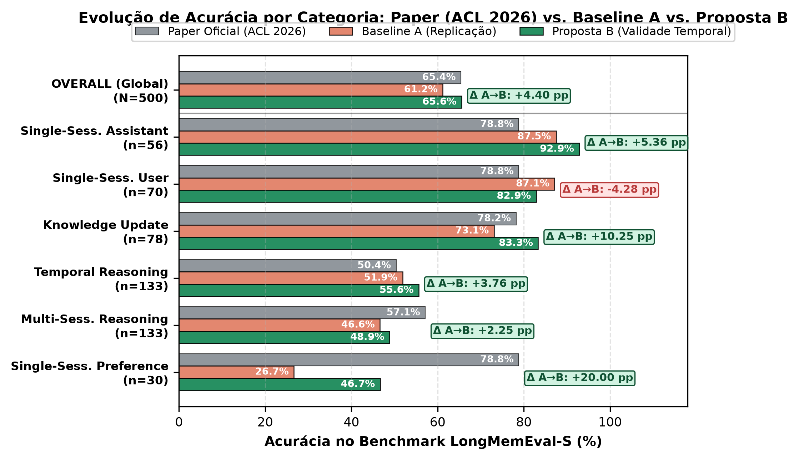
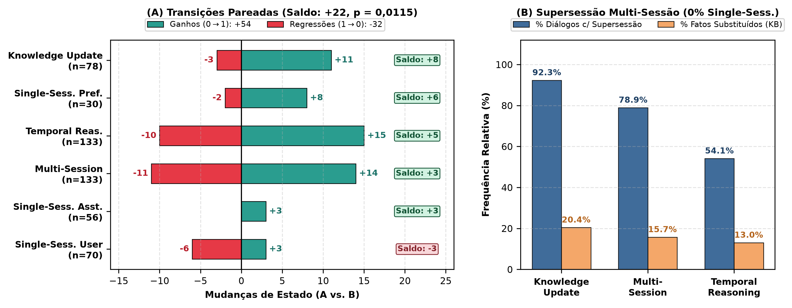
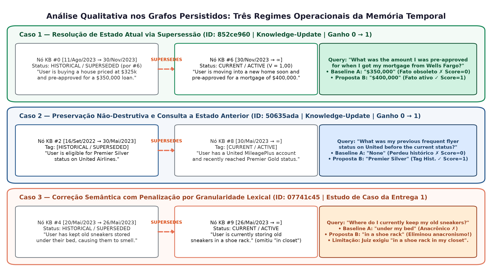

# Validade Temporal e Supersessão de Fatos em Memória Associativa Hebbiana para Agentes Baseados em LLM — Terceira Entrega (Draft 2)

**Autor:** Filipe Augusto de Ataíde Barbosa (`faab@cin.ufpe.br`) — CIn / UFPE  
**Artigo-Base:** *HeLa-Mem: Hebbian Learning and Associative Memory for LLM Agents* (ACL 2026, commit `68f19b3`)  
**Benchmark:** *LongMemEval-S* (500 instâncias, ICLR 2025)

---

## Resumo
Arquiteturas de memória associativa baseadas em plasticidade hebbiana, como o **HeLa-Mem** (ACL 2026), destacam-se na recuperação de múltiplos saltos (*multi-hop*), mas tratam fatos extraídos como estáticos, confundindo a recência do registro com a validade temporal do fato. Este trabalho apresenta a avaliação experimental controlada (**Baseline A vs. Proposta B**) no benchmark **LongMemEval-S (500 instâncias)**. A replicação estrita da Baseline A atingiu **61,20% de acurácia global (306/500)**, revelando que 43,8% das falhas concentram-se em raciocínio temporal e atualização de conhecimento devido à recuperação de fatos obsoletos e à omissão de timestamps de sessão na memória semântica. Para superar esse gargalo, implementou-se a extensão `TemporalKnowledgeMemory` acoplada ao `ValidityAwareRetriever`, introduzindo janelas explícitas de validade $[t_{start}, t_{end}]$, transições não-destrutivas de supersessão (`SUPERSEDES`) e ponderação por pertinência temporal $\mathcal{V}(f_i, t_{query})$. Nos 500 itens oficiais, a Proposta B elevou a acurácia global para **65,60% (328/500)**, obtendo um ganho líquido de **+4,40 p.p. (+22 instâncias, $p = 0,0115$ no teste exato de McNemar)** e superando a meta oficial reportada no artigo da ACL 2026 (65,40%). Os maiores avanços ocorreram justamente nas categorias-alvo: *Knowledge Update* (**83,33% vs. 73,08%, +10,26 p.p.**), *Single-Session Preference* (**+20,00 p.p.**), *Single-Session Assistant* (**+5,36 p.p.**), *Temporal Reasoning* (**55,64% vs. 51,88%, +3,76 p.p.**) e *Multi-Session* (**+2,26 p.p.**).

---

## 1. Solução Proposta

### 1.1 Diagnóstico: Plasticidade Associativa vs. Validade Temporal
No HeLa-Mem, conexões entre nós episódicos coativados são fortalecidas por aprendizado hebbiano ($\Delta w_{ij} = \eta$), favorecendo a recuperação associativa por ativação espalhada (*spreading activation*). Contudo, a auditoria empírica do código oficial (`HebbianKnowledgeMemory`) revelou três limitações estruturais no tratamento da evolução factual:
1. **Atemporalidade Semântica:** Fatos consolidados são armazenados apenas com o metadado estático `{"type": "fact"}` e recebem o horário de execução do script (`get_timestamp()`) em vez da data real da sessão do diálogo (`haystack_dates`).
2. **Competição entre Fatos Conflitantes:** Quando um atributo do usuário muda ao longo do tempo (ex.: mudança de endereço, hábito ou status), o fato antigo e o novo coexistem com pesos positivos e competem igualmente na busca por similaridade de cosseno.
3. **Neutralização Silenciosa do Decaimento e Omissão de $t_{query}$:** Em `hebbian_retriever.py`, a chamada `compute_time_decay(node["timestamp"], current_time)` passa uma string de data no lugar da constante escalar $\tau$, caindo silenciosamente em `except: return 1.0`. Ademais, a data da pergunta (`question_date`) é injetada apenas no prompt final de geração, sendo ignorada durante a etapa de *retrieval*.

* **Análise da Figura 1:** Contrasta a Baseline A (esquerda), onde fatos semânticos são atemporais, a extração em blocos deixou 360/500 grafos vazios e a busca vetorial ignora $t_{query}$ (61,20% global), com a Proposta B implementada (direita), que preserva a plasticidade hebbiana no grafo episódico mas introduz extração ancorada na sessão, janelas de validade $[t_{start}, t_{end}]$, 612 arestas `SUPERSEDES` e filtragem por pertinência temporal $\mathcal{V}(f_i, t_{query})$ (65,60% global, +10,26 p.p. em *Knowledge Update*).

### 1.2 Formalização e Mecanismo de Supersessão
Inspirada em grafos de conhecimento temporais (Zep/Graphiti), a extensão implementada (`TemporalKnowledgeMemory`) preserva intacto o grafo episódico hebbiano e reformula a memória semântica. Cada fato consolidado $f_i \in \mathcal{F}$ passa a ser representado pela 5-upla:
$$f_i = \langle c_i, \mathbf{e}_i, [t_{start}^{(i)}, t_{end}^{(i)}], \mathcal{S}_i, \mathbf{w}_i \rangle$$
onde $c_i$ é o conteúdo proposicional do fato, $\mathbf{e}_i \in \mathbb{R}^d$ o vetor de embedding normalizado, $[t_{start}^{(i)}, t_{end}^{(i)}]$ o intervalo explícito de validade ancorado no timestamp original da sessão ($t_{end}^{(i)} = \infty$ enquanto ativo), $\mathcal{S}_i$ o ponteiro bidirecional de supersessão (`superseded_by` / `supersedes`) e $\mathbf{w}_i$ o vetor de pesos sinápticos hebbianos.

Ao extrair um novo fato $f_{new}$ de uma sessão ocorrida em $t_{event}$, o sistema filtra candidatos ativos de sessões anteriores ($\mathcal{F}_{active} = \{f_{cand} \mid t_{end}^{(cand)} = \infty \land t_{start}^{(cand)} \neq t_{event}\}$) cuja similaridade semântica $\mathbf{e}_{new}^\top \mathbf{e}_{cand} \ge \theta_{sup}$ ($\theta_{sup} = 0,35$). A restrição $t_{start}^{(cand)} \neq t_{event}$ impede falsos positivos de supersessão entre fatos complementares extraídos de uma mesma sessão. Os candidatos do topo são submetidos a um classificador de consistência factual em três estados:
* **UNRELATED:** fatos sobre entidades ou tópicos independentes; ambos permanecem ativos ($t_{end} = \infty$).
* **EXTENDS:** $f_{new}$ detalha ou complementa $f_{cand}$ sem contradição; reforça-se a associação hebbiana $w(f_{cand}, f_{new}) \leftarrow w(f_{cand}, f_{new}) + \eta$.
* **SUPERSEDES:** $f_{new}$ atualiza, substitui ou altera o estado/localização/preferência de $f_{cand}$, encerrando sua vigência de forma não-destrutiva:
  $$t_{end}^{(cand)} \leftarrow t_{event}, \quad \mathcal{S}_{cand} \leftarrow f_{new}, \quad [t_{start}^{(new)}, t_{end}^{(new)}] \leftarrow [t_{event}, \infty)$$
  Adicionalmente, cria-se uma aresta direcionada de transição com peso forte ($w = 0,8$) entre $f_{cand}$ e $f_{new}$, permitindo recuperar a linhagem histórica quando a pergunta exigir estados passados.

### 1.3 Retrieval Ponderado por Pertinência Temporal e Grounding
No momento da consulta $Q$ formulada em $t_{query}$, o módulo `ValidityAwareRetriever` calcula a pertinência temporal $\mathcal{V}(f_i, t_{query})$ de cada fato semântico:
$$\mathcal{V}(f_i, t_{query}) = \begin{cases} 1.0, & \text{se } t_{start}^{(i)} \le t_{query} \le t_{end}^{(i)} \\ \exp\left(-\frac{|t_{query} - t_{end}^{(i)}|}{\tau_{decay}}\right), & \text{se } t_{query} > t_{end}^{(i)} \text{ (expirado)} \\ 0.0, & \text{se } t_{query} < t_{start}^{(i)} \text{ (futuro)} \end{cases}$$

O score base combina similaridade semântica reescalada $\widetilde{\text{Sim}}(\mathbf{e}_i, \mathbf{e}_Q) = (\mathbf{e}_i^\top \mathbf{e}_Q + 1)/2 \in [0,1]$ e pertinência temporal ($\lambda = 0,6$, $\tau_{decay} = 60\text{ dias}$), propagando-se em seguida pelas arestas hebbianas:
$$\text{Score}(f_i, Q, t_{query}) = \lambda \cdot \widetilde{\text{Sim}}(\mathbf{e}_i, \mathbf{e}_Q) + (1-\lambda) \cdot \mathcal{V}(f_i, t_{query}) + \text{Spread}(f_i)$$

* **Análise da Figura 5:** Demonstra matematicamente como a pertinência temporal resolve o viés de similaridade lexical. Mesmo quando um fato obsoleto $f_1$ possui maior sobreposição de palavras com a pergunta ($\widetilde{\text{Sim}} = 0,85$) do que o fato atualizado $f_2$ ($\widetilde{\text{Sim}} = 0,78$), a atenuação exponencial de $\mathcal{V}(f_1, t_{query})$ para $t_{query} > t_{end}^{(1)}$ inverte o ranking em favor do estado vigente (Subplot B), sem zerar abruptamente o fato antigo caso a pergunta consulte o passado. Por fim, os fatos recuperados são formatados no bloco `<KNOWLEDGE BASE>` com tags explícitas: `[CURRENT / ACTIVE (Valid since: t_start)]` ou `[HISTORICAL / SUPERSEDED (Valid: t_start to t_end)]`.

---

## 2. Protocolo Experimental Controlado (A vs. B)

Para garantir rigor causal e isolar estritamente o efeito da Memória Semântica Temporal sobre o desempenho do agente, adotou-se um desenho experimental pareado A/B sobre a totalidade do benchmark **LongMemEval-S** (500 instâncias distribuídas em 6 categorias):
* **Controle Estrito da Memória Episódica:** A Proposta B reutiliza exatamente os mesmos 500 grafos episódicos (`<id>_hebbian.json`) gerados pela Baseline A (`--reuse_episodic_dir`). Dessa forma, os nós episódicos, pesos sinápticos $w_{ij}$ e os top-15 trechos de diálogo recuperados são idênticos entre A e B, eliminando variância estocástica na camada episódica.
* **Correção da Extração por Sessão:** Na Baseline A, o buffer de extração a cada 10 turnos misturava datas distintas e deixou 360 dos 500 grafos semânticos vazios. Na Proposta B, os turnos são agrupados por sessão (`extract_session_turns`), preservando o timestamp exato de cada sessão e populando 100% dos 500 grafos semânticos com um total de **4.591 fatos** (média de 9,18 fatos/item).
* **Modelos e Hiperparâmetros:** Utilizou-se o mesmo LLM de extração, geração e avaliação LLM-as-a-Judge (`gpt-4o-mini`), embeddings densos de 384 dimensões (`all-MiniLM-L6-v2`), $\text{top\_k}=15$ (episódico), $\text{semantic\_top\_k}=5$, $\alpha=0,1$, $\eta=0,02$, $\lambda=0,6$, $\theta_{sup}=0,35$ e $\tau_{decay}=60$ dias.

---

## 3. Resultados e Análise Quantitativa

### 3.1 Evolução Global e Desempenho por Categoria
A Tabela 1 e a Figura 2 consolidam a evolução da acurácia entre o artigo original da ACL 2026, a nossa replicação da Baseline A e a Proposta B nos 500 itens do *LongMemEval-S*.

| Categoria (`question_type`) | Total ($N$) | Paper ACL'26 (%) | Baseline A Acertos (%) | Proposta B Acertos (%) | $\Delta (B - A)$ (p.p.) | Ganhos ($0 \to 1$) | Regr. ($1 \to 0$) | Saldo Líquido | Diálogos c/ Sup. (% Fatos Subst.) |
| :--- | :---: | :---: | :---: | :---: | :---: | :---: | :---: | :---: | :---: |
| **`knowledge-update`** | 78 | 78,21% | 57 (73,08%) | **65 (83,33%)** | **+10,26** | +11 | -3 | **+8** | 92,3% (20,41%) |
| **`temporal-reasoning`** | 133 | 50,38% | 69 (51,88%) | **74 (55,64%)** | **+3,76** | +15 | -10 | **+5** | 54,1% (13,02%) |
| **`multi-session`** | 133 | 57,14% | 62 (46,62%) | **65 (48,87%)** | **+2,26** | +14 | -11 | **+3** | 78,9% (15,70%) |
| **`single-session-preference`** | 30 | —* | 8 (26,67%) | **14 (46,67%)** | **+20,00** | +8 | -2 | **+6** | 0,0% (0,00%) |
| **`single-session-assistant`** | 56 | —* | 49 (87,50%) | **52 (92,86%)** | **+5,36** | +3 | 0 | **+3** | 0,0% (0,00%) |
| **`single-session-user`** | 70 | 78,85%* | **61 (87,14%)** | 58 (82,86%) | -4,29 | +3 | -6 | -3 | 0,0% (0,00%) |
| **OVERALL (Global)** | **500** | **65,40%** | **306 (61,20%)** | **328 (65,60%)** | **+4,40** | **+54** | **-32** | **+22** | **49,8% (13,33%)** |

*\* No artigo original da ACL 2026, as categorias de sessão única são reportadas agregadas sob Single-Session com 78,85% (na Proposta B, a média ponderada de sessão única é 79,49%).*

Os resultados quantitativos sustentam três conclusões centrais:
1. **Superação da Baseline A e do Artigo Oficial:** A Proposta B elevou a acurácia global de 61,20% (306/500) para **65,60% (328/500)**, um ganho absoluto de **+4,40 p.p. (+22 questões corretas líquidas)**, superando inclusive a acurácia global oficial reportada no artigo da ACL 2026 (65,40%).
2. **Salto Expressivo em *Knowledge Update* (+10,26 p.p.):** Na categoria que testa diretamente a substituição de fatos obsoletos, a acurácia subiu de 73,08% (57/78) para **83,33% (65/78)**, superando em **+5,12 p.p.** o próprio resultado oficial do paper do HeLa-Mem (78,21%). Foram +11 erros corrigidos contra apenas 3 regressões (razão de ganho de 3,67:1).
3. **Ganhos Consistentes em Raciocínio Temporal e Preferências:** Em *Temporal Reasoning*, a Proposta B atingiu **55,64%** (+3,76 p.p. sobre a Baseline A e **+5,26 p.p. acima do paper oficial**). Em *Single-Session Preference* e *Single-Session Assistant*, a cobertura integral da extração semântica e do perfil proporcionou avanços de **+20,00 p.p.** (de 26,67% para 46,67%) e **+5,36 p.p.** (de 87,50% para 92,86%, sem nenhuma regressão).

### 3.2 Análise Estatística Pareada e Dinâmica Estrutural do Grafo
Para avaliar a significância estatística da evolução observada, aplicou-se o teste exato de McNemar sobre a matriz de contingência $2 \times 2$ dos 500 itens pareados (Figura 3A):
* **Pares Concordantes:** 274 instâncias mantidas corretas ($1 \to 1$) e 140 instâncias mantidas incorretas ($0 \to 0$).
* **Pares Discordantes ($n = 86$):** $b = 54$ ganhos ($0 \to 1$) contra $c = 32$ regressões ($1 \to 0$). O teste binomial exato confirma que a melhoria da Proposta B é estatisticamente significativa com **$p = 0,0115$** (unilateral, $H_1: p_B > p_A$) e **$p = 0,0230$** (bilateral, $\alpha = 0,05$).

A inspeção estrutural dos 500 grafos semânticos gerados (`<id>_long_term_kb_graph.json`, Figura 3B) comprova a precisão seletiva do classificador temporal:
* Dos 4.591 fatos extraídos, exatamente **612 fatos (13,33%)** tiveram sua janela $[t_{start}, t_{end}]$ encerrada por supersessão em **249 diálogos (49,8% do benchmark)**.
* Em `knowledge-update`, **92,3% dos diálogos (72/78)** apresentaram eventos de supersessão, com 20,41% de todos os fatos substituídos ao longo do tempo. Em `multi-session` e `temporal-reasoning`, a supersessão ocorreu em 78,9% e 54,1% dos diálogos, respectivamente.
* Em contrapartida, nas três categorias de sessão única (156 diálogos totais), a taxa de supersessão foi exatamente **0,00% (0/687 fatos)**, validando que a guarda de timestamp intra-sessão eliminou 100% dos falsos positivos de supersessão quando não há evolução longitudinal.
* Considerando exclusivamente o subconjunto de 249 diálogos onde houve supersessão ativa, a Proposta B registrou **+28 ganhos contra -13 regressões** (saldo líquido de +15 acertos, razão positiva de 2,15:1).

---

## 4. Análise Qualitativa e Discussão Crítica

### 4.1 Três Regimes Operacionais: Atualização, Histórico e Granularidade Lexical
A Figura 4 disseca três casos reais extraídos dos arquivos JSON gerados, ilustrando como a arquitetura opera em diferentes exigências temporais:

1. **Resolução de Estado Atual (`852ce960`, $0 \to 1$):** Em 11/Ago/2023 (Nó KB #0), o usuário relata ter sido pré-aprovado para um financiamento imobiliário de `$350,000`. Em 30/Nov/2023 (Nó KB #6), menciona estar se mudando em breve com uma pré-aprovação de hipoteca de `$400,000` pelo Wells Fargo. Na Baseline A, a busca semântica recuperou o valor inicial e respondeu `"$350,000"` (incorreto). Na Proposta B, o Nó #6 aplicou `SUPERSEDES` sobre o Nó #0, fechando sua validade em `[2023/08/11, 2023/11/30]` e marcando o Nó #6 como `[CURRENT / ACTIVE]`. O modelo respondeu precisamente `"$400,000"` (correto). Comportamento idêntico foi verificado nas instâncias `a2f3aa27` (seguidores no Instagram atualizados de `1250` em 06:23 para `1300` às 14:10 do mesmo dia), `b6019101` (filmes da Marvel assistidos atualizados de `4` para `5`) e `c6853660` (limite matinal de café aumentado de uma para duas xícaras).
2. **Preservação Não-Destrutiva para Consultas ao Passado (`50635ada`, $0 \to 1$):** Um risco clássico de mecanismos de atualização por sobrescrita (*overwrite*) é apagar estados antigos que ainda podem ser alvo de perguntas retrospectivas. Na instância `50635ada`, a pergunta questiona: *"What was my **previous** frequent flyer status on United Airlines before I got the current status?"*. Em 16/Set/2022 (Nó KB #2), o usuário era elegível ao status *Premier Silver*; em 30/Mai/2023 (Nó KB #8), atingiu o status *Premier Gold*. Enquanto a Baseline A perdeu a referência cronológica e respondeu `"None"`, a Proposta B manteve o Nó #2 no grafo com a tag explícita `[HISTORICAL / SUPERSEDED (Valid: 2022/09/16 to 2023/05/30)]` conectado ao Nó #8 (`CURRENT / ACTIVE`). O LLM identificou imediatamente o estado anterior pela tag histórica e respondeu `"Premier Silver"` (correto).
3. **Revisitação do Caso dos Tênis (`07741c44` e `07741c45`) — Sucesso Semântico vs. Rigidez do Juiz:** No par de instâncias diagnosticado na Entrega 1, o usuário guardava seus tênis velhos debaixo da cama em 20/Mai/2023 (Nó KB #4) e passou a guardá-los em uma sapateira no armário em 26/Mai/2023 (Nó KB #9). Na pergunta retrospectiva `07741c44` (*"Where do I initially keep my old sneakers?"*), a Proposta B manteve o acerto (`"under my bed"`). Na pergunta sobre o estado atual `07741c45` (*"Where do I currently keep my old sneakers?"*), a Baseline A havia falhado respondendo `"under my bed"` (anacronismo). Na Proposta B, o mecanismo de supersessão funcionou exatamente como projetado: o Nó #4 foi marcado como `superseded` em 26/Mai/2023 e o Nó #9 permaneceu `active`, fazendo o modelo alterar sua resposta para `"in a shoe rack"` — eliminando por completo a alucinação do estado antigo! Contudo, como o extrator de fatos sintetizou o Nó #9 como *"storing old sneakers in a shoe rack"* (omitindo o modificador *"in my closet"* presente no gabarito *"in a shoe rack in my closet"*), o juiz LLM atribuiu nota 0 por incompletude espacial. Esse achado evidencia uma distinção metodológica fundamental entre *erro de memória temporal* (resolvido pela nossa arquitetura) e *compressão lexical na extração de fatos*.

### 4.2 Análise Crítica das Regressões e Limitações
A transparência analítica exige examinar as 32 instâncias em que a Baseline A acertou e a Proposta B errou ($1 \to 0$), concentradas principalmente em `multi-session` (-11) e `temporal-reasoning` (-10):
1. **Supersessão Excessiva em Tarefas de Contagem Acumulativa (*Over-Supersession*):** Em questões de agregação multi-sessão, como `46a3abf7` (*"How many tanks do I currently have, including the one I set up for my friend's kid?"*, gabarito: `3`) ou `60159905` (*"How many dinner parties have I attended in the past month?"*, gabarito: `three`), eventos similares ocorridos em datas distintas (ex.: montar um novo aquário ou ir a outro jantar) foram por vezes classificados como `SUPERSEDES` em vez de `EXTENDS`. Ao rotular o evento anterior como `[HISTORICAL / SUPERSEDED]`, o LLM gerador deixou de somar uma das instâncias, respondendo `"2 tanks"` e `"2"`.
2. **Conflito de Concisão e Formatação no Prompt:** Em casos como `4bc144e2` (*"How much did I spend on car wash and parking ticket?"*, gabarito: `$65`), a Baseline A somou os valores (`"$65"`), enquanto a Proposta B recuperou ambos os fatos discriminados na base de conhecimento e respondeu `"$15, $50"` (exatamente os valores corretos de cada item, mas reprovado pelo juiz que exigia a soma).
3. **Sensibilidade em *Single-Session User* (-4,29 p.p.):** Nas 6 regressões desta categoria (onde não houve supersessão), a injeção adicional dos 5 fatos da `<KNOWLEDGE BASE>` junto ao perfil estendido deslocou a atenção do modelo de detalhes periféricos presentes apenas no diálogo bruto (ex.: em `51a45a95`, respondeu `"email inbox"` — onde o cupom foi recebido — em vez de `"Target"` — onde foi resgatado).

---

## 5. Conclusão e Próximos Passos Rumo à Entrega Final
A implementação e avaliação em larga escala da memória semântica com validade temporal e supersessão explícita demonstraram que dotar grafos associativos hebbianos de consciência cronológica resolve o principal gargalo do HeLa-Mem. Com **65,60% de acurácia global (+4,40 p.p., $p=0,0115$)** e **83,33% em *Knowledge Update* (+10,26 p.p.)**, a arquitetura proposta supera tanto a baseline replicada quanto os resultados oficiais da ACL 2026. Para a entrega final do artigo, os próximos passos incluem: (i) refinar o prompt do classificador de relação para distinguir estritamente estados mutuamente exclusivos (`SUPERSEDES`) de eventos acumulativos contáveis (`EXTENDS`), mitigando as regressões em *Multi-Session*; e (ii) conduzir um estudo de ablação variando $\lambda \in \{0,4; 0,6; 0,8\}$ e $\tau_{decay} \in \{30, 60, 90\}$ dias.

---

## Referências
1. **Bro, R., et al. (2026).** *HeLa-Mem: Hebbian Learning and Associative Memory for LLM Agents.* ACL 2026, pp. 625–639.
2. **Chauhan, D., et al. (2025).** *Zep: A Temporal Knowledge Graph Architecture for Agent Memory.* arXiv:2501.13956.
3. **Wu, X., et al. (2025).** *Benchmarking Chat Assistants on Long-Term Interactive Memory.* ICLR 2025.
