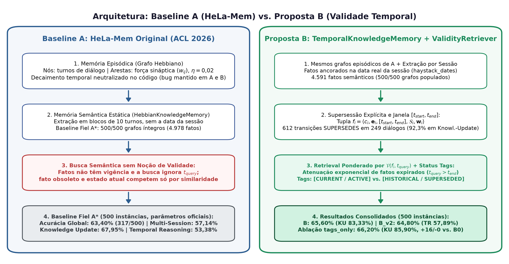
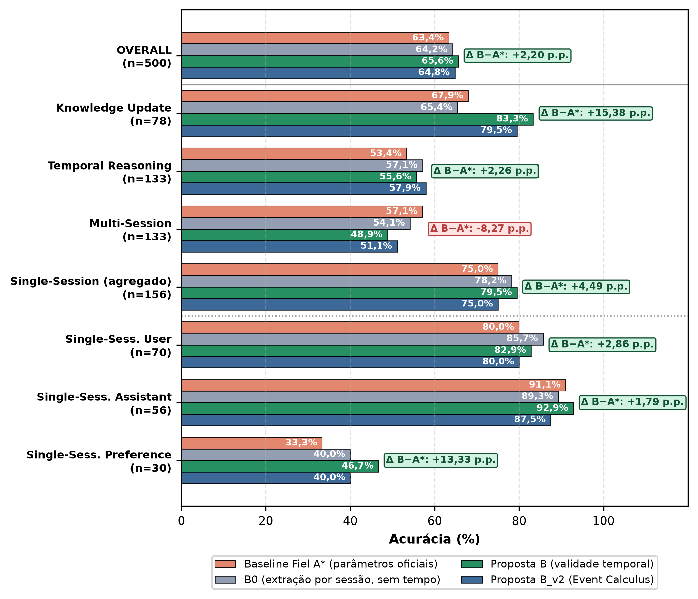
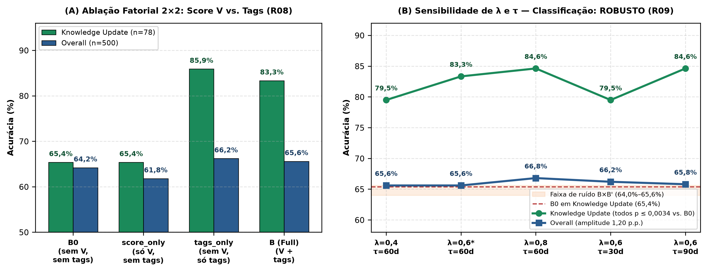

# Validade Temporal e Supersessão de Fatos em Memória Associativa Hebbiana para Agentes Baseados em LLM — Relatório Final Consolidado

**Autor:** Filipe Augusto de Ataíde Barbosa (`faab@cin.ufpe.br`) — CIn / UFPE  
**Disciplina:** Deep Learning — Mestrado (Prof. Cleber Zanchettin)  
**Artigo-Base:** *HeLa-Mem: Hebbian Learning and Associative Memory for LLM Agents* (ACL 2026, commit `68f19b3`)  
**Benchmark:** *LongMemEval* (500 instâncias distribuídas com o código oficial — variante *oracle*, apenas sessões de evidência)  
**Versão LaTeX IEEE:** [`reports/relatorio_final_ieee.tex`](relatorio_final_ieee.tex)

---

## Resumo

Memórias associativas hebbianas como o **HeLa-Mem** (ACL 2026) tratam fatos semânticos extraídos como estáticos, sem distinguir quando um fato foi registrado de quando deixou de ser verdadeiro. Este trabalho estende a memória semântica do HeLa-Mem com janelas explícitas de validade $[t_{start}, t_{end}]$, supersessão não-destrutiva (`SUPERSEDES`), pertinência temporal $\mathcal{V}(f_i, t_{query})$ e sinalização de vigência no prompt (`[CURRENT]`/`[HISTORICAL]`).

Sobre as 500 questões do *LongMemEval* distribuídas com o código oficial:
1. Estabeleceu-se uma **Baseline Fiel ($A^*$)** com 100% dos grafos íntegros e parâmetros oficiais (`63,40%` geral; `multi-session` em `57,14%`, idêntico ao artigo) e uma ablação controlada (**$B_0$**, extração por sessão sem mecanismo temporal, `64,20%`).
2. A **Proposta $B$** elevou `knowledge-update` de `67,95%` ($A^*$) e `65,38%` ($B_0$) para **`83,33%`** (+12 sobre $A^*$, McNemar bilateral $p = 0{,}0042$; +14/−0 sobre $B_0$, $p_{\text{Holm}} = 0{,}0015$), muito acima do piso de ruído medido na réplica independente **$B'$** (`97,44%` de estabilidade em KU).
3. Uma **ablação fatorial 2×2** (`R08`) revelou que, no recorte *oracle*, as etiquetas de vigência (**`tags_only`**: `66,20%` geral; **`85,90%`** em KU, +16/−0) explicam 100% do ganho, enquanto o re-ranking isolado por $\mathcal{V}$ (`score_only`) tem efeito nulo em KU (`65,38%`).
4. A variante ontológica sem exemplos de domínio (**$B_{\text{v2}}$**, *Event Calculus*) cortou o volume de supersessões em **53,6%** (`612 → 284`), elevou a precisão auditada de **33,3% → 48,9%** (`R07`) e atingiu recorde em `temporal-reasoning` (**`57,89%`**), mantendo significância em KU (`79,49%`, $p = 0{,}0117$ vs. $A^*$).
5. A análise de sensibilidade em $\lambda \in \{0{,}4; 0{,}6; 0{,}8\}$ e $\tau \in \{30, 60, 90\}$ dias (`R09`) classificou o resultado como **ROBUSTO** (amplitude global de `1,20 p.p.`, KU entre `79,49%` e `84,62%`).

---

## 1. Arquitetura e Solução Proposta

- **Diagnóstico do HeLa-Mem oficial:** (1) fatos semânticos recebem `get_timestamp()` em vez da data da sessão (`haystack_dates`); (2) fatos conflitantes competem em pé de igualdade por similaridade; (3) `compute_time_decay` recebe uma string no lugar de $\tau$ e cai silenciosamente em `return 1.0`, enquanto `question_date` é ignorada no *retrieval*.
- **Extensão (`TemporalKnowledgeMemory` + `ValidityAwareRetriever`):** cada fato $f_i = \langle c_i, \mathbf{e}_i, [t_{start}^{(i)}, t_{end}^{(i)}], \mathcal{S}_i, \mathbf{w}_i \rangle$ passa por classificação de relação (`UNRELATED`, `EXTENDS`, `SUPERSEDES`) contra candidatos ativos de sessões anteriores ($\theta_{sup}=0{,}35$). Em `SUPERSEDES`, encerra-se $t_{end}^{(cand)} \leftarrow t_{event}$ de forma não-destrutiva e cria-se aresta bidirecional $w=0{,}8$. Na busca, aplica-se $\mathcal{V}(f_i, t_{query})$ com $\lambda=0{,}6, \tau=60\text{d}$ e formatação com etiquetas `[CURRENT / ACTIVE]` e `[HISTORICAL / SUPERSEDED]`.
- **Variante Ontológica ($B_{\text{v2}}$):** remove exemplos de domínio do prompt e restringe `SUPERSEDES` a atributos unívocos/estados mutuamente exclusivos (*Event Calculus*), mantendo eventos históricos e entidades coexistentes como `EXTENDS`.

---

## 2. Resultados Consolidados ($N = 500$)

### 2.1 Tabela Geral por Categoria

| Categoria (`question_type`) | $N$ | Baseline Fiel ($A^*$) | Ablação $B_0$ | Proposta $B$ | Proposta $B_{\text{v2}}$ | `tags_only` |
| :--- | :---: | :---: | :---: | :---: | :---: | :---: |
| `knowledge-update` | 78 | 53 (67,95%) | 51 (65,38%) | 65 (83,33%)* | 62 (79,49%)* | **67 (85,90%)*** |
| `temporal-reasoning` | 133 | 71 (53,38%) | 76 (57,14%) | 74 (55,64%) | **77 (57,89%)** | 75 (56,39%) |
| `multi-session` | 133 | **76 (57,14%)** | 72 (54,14%) | 65 (48,87%) | 68 (51,13%) | 68 (51,13%) |
| `single-session-preference` | 30 | 10 (33,33%) | 12 (40,00%) | **14 (46,67%)** | 12 (40,00%) | 11 (36,67%) |
| `single-session-assistant` | 56 | 51 (91,07%) | 50 (89,29%) | **52 (92,86%)** | 49 (87,50%) | 51 (91,07%) |
| `single-session-user` | 70 | 56 (80,00%) | **60 (85,71%)** | 58 (82,86%) | 56 (80,00%) | 59 (84,29%) |
| **OVERALL** | **500** | **317 (63,40%)** | **321 (64,20%)** | **328 (65,60%)** | **324 (64,80%)** | **331 (66,20%)** |

*\* McNemar bilateral em `knowledge-update`: $A^*\!\rightarrow\!B$ ($p=0{,}0042$), $A^*\!\rightarrow\!B_{\text{v2}}$ ($p=0{,}0117$), $B_0\!\rightarrow\!B$ ($p_{\text{Holm}}=0{,}0015$), $B_0\!\rightarrow\!\texttt{tags\_only}$ ($p<0{,}0001$).*

### 2.2 Ablação Fatorial 2×2 (`R08`) e Sensibilidade (`R09`)

- **Ranking ($\mathcal{V}$) vs. Etiquetas (`R08`):** `score_only` obteve `61,80%` global e `65,38%` (51/78) em KU (efeito nulo frente a $B_0$, `+3/-3`, $p=1{,}000$). `tags_only` obteve `66,20%` global e `85,90%` (67/78) em KU (**+16/−0**, $p<0{,}0001$). No recorte *oracle* (~9 fatos/grafo, `top_k=5`), ambos os fatos entram no contexto; as etiquetas resolvem a interferência factual.
- **Sensibilidade (`R09`):** $\lambda \in \{0{,}4; 0{,}6; 0{,}8\}$ e $\tau \in \{30\text{d}, 60\text{d}, 90\text{d}\}$ mantiveram o resultado global entre `65,60%` e `66,80%` (amplitude `1,20 p.p.` < piso de ruído `1,60 p.p.`) e KU entre `79,49%` e `84,62%` (todos $p \le 0{,}0034$ vs. $B_0$). Classificação: **ROBUSTO**; configuração reportada mantida em $\lambda=0{,}6, \tau=60\text{d}$.

---

## 3. Auditoria de Precisão da Supersessão (`R07`) e Limitações

- **Precisão auditada ($n=45$/sistema):** subiu de `33,3%` ($B$) para `48,9%` ($B_{\text{v2}}$), com salto de `13,3% → 53,3%` em `temporal-reasoning`. Em `multi-session`, a precisão ainda baixa (`26,7%`) explica as regressões residuais em tarefas de contagem.
- **Achado estrutural no dataset:** **34/500 itens** têm `haystack_dates` fora de ordem cronológica no JSON, gerando supersessões reversas ($t_{end} < t_{start}$) em `5,6%` das arestas de $B$ e `3,2%` de $B_{\text{v2}}$ — 100% concentradas em `temporal-reasoning`.
- **Limitações:** variante *oracle* (1–6 sessões de evidência, sem comparação numérica direta com a Tabela 6 do artigo-base); juiz LLM da mesma família do gerador (`gpt-4o-mini`); $\theta_{sup}=0{,}35$ não variado; *LongMemEval-S* completo e *LoCoMo* como trabalhos futuros.

---

## 4. Conclusão

A hipótese de pesquisa é **fortemente suportada em atualização de conhecimento** (confirmada contra $A^*$ e $B_0$, estável frente a ruído $B'$ e robusta em $\lambda$ e $\tau$) e **não suportada como ganho global significativo** devido ao trade-off de *over-supersession* em `multi-session`, parcialmente mitigado pela formulação ontológica $B_{\text{v2}}$.
